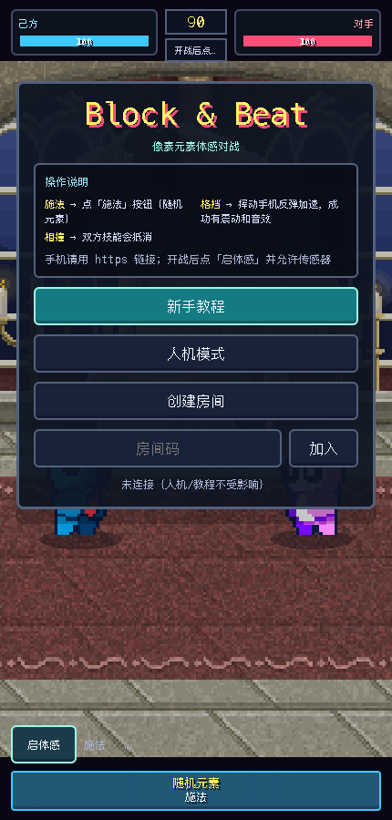

# Block & Beat

基于 Phaser、TypeScript 和 WebSocket 的双人法术对战原型。玩家创建或加入房间，双方准备后开始对局。



## 本地运行

需要 Node.js 22 或更高版本。

```bash
npm ci
npm run server
```

另开一个终端运行：

```bash
npm run dev
```

打开 Vite 输出的 HTTPS 地址（默认 `https://localhost:5173`）。开发证书为自签名证书。分别在两个浏览器窗口创建、加入同一房间；双方点击准备后开始。

开发时浏览器连接同源 `/ws`，Vite 将其转发到本机 `8787` 端口的 WebSocket 服务，因此 HTTPS 页面不会尝试连接没有 TLS 的 `wss://localhost:8787`。

## 验证与构建

```bash
npm test
npm run build
```

单元测试覆盖模拟逻辑、连接生命周期、法术、音效与输入。真实 WebSocket 集成测试覆盖满员拒绝、重复入房、格挡后双方状态一致、冷却、胜负、重开与退出后重新入房。

`npm run server` 会先将 `src/shared/` 的 TypeScript 规则编译到忽略提交的 `.server-build/`，再启动服务；服务端与离线客户端共用规则源码。

## 部署与当前限制

- 前端构建输出到 `dist/`；该目录由构建产生，不提交到源码仓库。
- WebSocket 服务需要独立的 Node.js 进程。单独部署静态前端不会自动部署该服务。
- 构建前通过 `VITE_WS_URL` 指定部署后的 `wss://` 地址，或设置 `VITE_ONLINE_ENABLED=true` 并在反向代理上将同源 `/ws` 转发到 WebSocket 服务。
- 房间保存在进程内存中，服务重启会丢失；没有账户、身份验证重连或持久化战绩。
- 服务端每 50 ms 更新对局并广播状态，统一判定施法冷却、格挡、伤害与胜负；前端在线模式只渲染状态，离线人机模式复用同一套规则。
- 返回首页会退出房间并清空连接；对手离开后，剩余玩家回到待准备状态。
- 当前适用于原型验证和熟人试玩，尚未实现公开服务所需的账户认证、完整流量限制或延迟补偿。格挡以服务器收到操作时的位置为准，高延迟会影响手感。
- 纯静态离线演示可设置 `VITE_ONLINE_ENABLED=false` 隐藏联机能力。

## 目录

```text
src/game/       Phaser 场景
src/shared/     模拟、法术与消息类型
src/input/      输入控制
src/audio/      声音系统
src/net/        WebSocket 客户端
server/         房间服务与集成测试
public/         运行时素材
```

早期包名为 `shoutbeat`，现统一为 `blockandbeat`。
